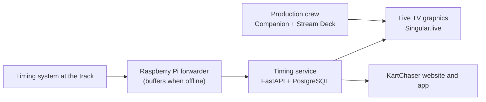

 

---

## About Me

I'm the Development Director at KartChaser, where we produce live broadcasts of professional karting races. I write most of the software that runs behind the scenes, and on race weekends I'm usually at the track making sure it all holds together.

Most of my time goes into our timing system. It takes the raw timing feed from the track, turns it into laps, positions and results as they happen, and sends that out to our on-screen graphics, the website and the app. Track internet is never great, so the Raspberry Pis that carry data from the timing stand to the cloud save everything locally and catch up once the connection comes back.

I'm finishing my IT degree at Florida International University here in Miami (graduating in 2027). Before KartChaser, I spent three summers interning at Chevron, building internal apps with Power Platform, Azure and .NET MAUI.

## How a race gets on screen

---

## What I'm Working On

- Real-time race timing and results for live TV graphics
- Trackside hardware that keeps working when the internet doesn't
- Custom Bitfocus Companion modules for our audio mixers and Singular.live graphics
- Automating the boring parts of broadcast day so the crew can focus on the race

## Tools I Reach For

## A Few Things I've Made

- [companion-module-kc-singularlive](https://github.com/Luisd07/companion-module-kc-singularlive): runs our broadcast graphics from Companion, up to 8 Singular.live apps at once
- [companion-module-behringer-x32-kc](https://github.com/Luisd07/companion-module-behringer-x32-kc): our take on the X32 module, with live audio meters and show presets for our mics
- [FSAE-Dashboard](https://github.com/Luisd07/FSAE-Dashboard): the dash display for my university's Formula SAE car, reading straight off the car's CAN bus
- [job-application-tracker](https://github.com/Luisd07/job-application-tracker): a Flask app I built to keep my own job search organized

## Activity

---

## Contact

I'm always happy to talk racing, broadcast tech or software.

- LinkedIn: [luisd07](https://www.linkedin.com/in/luisd07)
- GitHub: [@Luisd07](https://github.com/Luisd07)
- KartChaser: [kartchaser.com](https://kartchaser.com)

