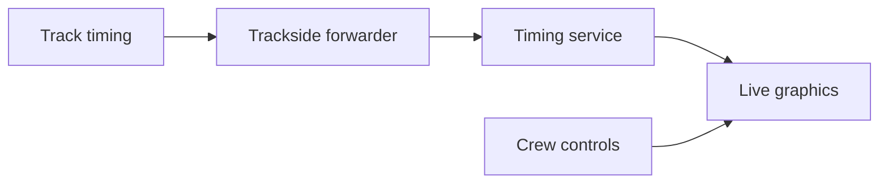

<div align="center">

<h1>Luis Diaz</h1>
<p><b>Software for live karting broadcasts</b></p>


</div>

```yaml
name:      Luis Diaz
role:      Development Director @ KartChaser
school:    Florida International University, IT '27
based:     Miami, FL
building:  live race timing and broadcast tools
```

[](https://www.linkedin.com/in/luisd07)

## 🏁 About Me

I'm the Development Director at KartChaser, where we produce live broadcasts of professional karting races. I write most of the software that runs behind the scenes, and on race weekends I'm usually at the track making sure it all holds together.

Most of my time goes into our timing system, which turns the raw feed from the track into laps, positions and results as they happen and puts them on screen. Before KartChaser, I spent three summers interning at Chevron.

## 📡 From the track to the screen



## 🛠️ What I Work With

| | |
|---|---|
| **Languages** |      |
| **Backend & Data** |     |
| **Cloud** |   |
| **Hardware** |   |

## 🏎️ Things I've Built

| | |
|---|---|
| 🎛️ [companion-module-kc-singularlive](https://github.com/Luisd07/companion-module-kc-singularlive) | Runs our broadcast graphics from Companion |
| 🎚️ [companion-module-behringer-x32-kc](https://github.com/Luisd07/companion-module-behringer-x32-kc) | X32 mixer control with live audio meters |
| 🏁 [FSAE-Dashboard](https://github.com/Luisd07/FSAE-Dashboard) | Dash display for FIU's Formula SAE car, straight off the CAN bus |
| 📋 [job-application-tracker](https://github.com/Luisd07/job-application-tracker) | Flask app for keeping a job search organized |

## 📈 Lap Chart


---

<p align="center">Always happy to talk racing, broadcast tech or code · <a href="https://www.linkedin.com/in/luisd07">LinkedIn</a> 🏁</p>
